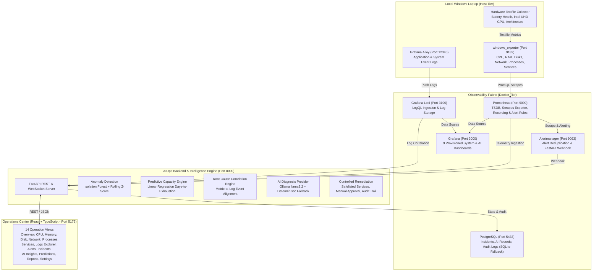

# Windows AIOps Monitoring & Intelligence Platform

[](https://microsoft.com)
[](https://prometheus.io)
[](https://grafana.com)
[](https://grafana.com/oss/loki/)
[](https://fastapi.tiangolo.com)
[](https://react.dev)
[](https://www.typescriptlang.org)
[](https://tailwindcss.com)

A complete, production-grade, locally hosted **AIOps (Artificial Intelligence for IT Operations)** platform designed specifically for Windows laptops and workstations. The platform continuously monitors system metrics, Windows event logs, hardware health, and operational events—employing machine learning anomaly detection, predictive capacity forecasting, automated root-cause cross-correlation, and LLM diagnostics to transform raw telemetry into actionable operational intelligence.

---

## Architecture Overview



---

## Key Features

### 1. Real-Time Telemetry & Hardware Monitoring
- **CPU**: Total & per-core utilization, user/privileged breakdown, interrupt frequency, and context switches.
- **Memory**: Total, used, available physical RAM, committed limit, paging file activity, and working set footprint.
- **Storage**: Volume capacity, read/write MB/s throughput, I/O latency, and free space percentage on logical disks (`C:`, `D:`).
- **Network**: Real-time upload/download throughput (Mbps), interface operational state, packet error and drop counters.
- **Processes & Services**: Top CPU and memory consuming processes, process IDs, and Windows service status matrix (Running/Stopped).
- **Genuine Hardware Sensors**: Real battery state of charge (percentage & minutes remaining), Intel UHD 620 GPU detection, and clear reporting of unsupported motherboard thermal sensors without fabrication.

### 2. Windows Event Log Aggregation
- Ingests native Windows **Application** and **System** event logs via **Grafana Alloy** into **Grafana Loki**.
- Automated severity classification: `Information`, `Warning`, `Error`, and `Critical`.
- In-depth search via LogQL query syntax directly through Grafana or the AIOps Web UI.

### 3. Python AIOps Intelligence Engine
- **Anomaly Detection**: Combines **Isolation Forest** (unsupervised machine learning) with dynamic **Rolling Z-Score** ($Z > 2.5$) over a 30-minute window to filter normal operational noise from genuine anomalies.
- **Predictive Capacity Forecasting**: Computes linear trend slopes to forecast disk space and memory exhaustion horizons (e.g., *74.2 days remaining on C:*), accompanied by statistical confidence metrics.
- **Automated Root-Cause Analysis (RCA)**: Upon detecting an incident (e.g., CPU spike at 95%), automatically correlates time-bounded Prometheus metric peaks with Loki log events, identifies the offending processes, and generates evidentiary proof.
- **AI-Powered Diagnostics**: Integrates with local **Ollama** (`llama3.2`) for natural language diagnosis. If Ollama is offline, automatically engages a **Deterministic Grounded AI Engine** with zero downtime or hallucination.

### 4. Controlled Remediation Framework
- Strict safelist-only execution model:
  - Windows Services: `Spooler` (Print Spooler), `W32Time` (Windows Time), `LanmanWorkstation` (Workstation).
  - Storage: System `%TEMP%` cache cleanup.
- **Two-phase approval**: Requires explicit operator confirmation before performing any corrective action.
- **Auditing**: Every remediation action, status, and output is permanently preserved in the database audit log.

### 5. 9 Production Grafana Dashboards
Provisioned automatically via JSON models with unified dark theme and automatic refresh:
1. **01 - Windows System Overview**: High-level health gauges, system uptime, active alerts, and battery status.
2. **02 - CPU Monitoring & Saturation**: Core-by-core load, privileged time, clock frequencies.
3. **03 - Memory & Paging Monitoring**: Available RAM, committed memory, page faults/sec.
4. **04 - Disk & Volume Storage**: Disk read/write rates, space exhaustion forecast, I/O saturation.
5. **05 - Network & Interface Analytics**: Real-time bandwidth gauges, interface state, dropped packets.
6. **06 - Process Resource Tracking**: Top 10 CPU/RAM consumers, thread counts, working sets.
7. **07 - Windows Services Health**: Service state monitoring and availability.
8. **08 - Windows Logs Explorer**: Real-time Loki LogQL event stream with severity filters.
9. **09 - AIOps Intelligence & Predictions**: Anomaly alerts, exhaustion countdowns, and AI diagnosis summaries.

### 6. Modern Operations Center Web UI
Built with React 18, TypeScript, Tailwind CSS, Lucide icons, and Recharts:
- **14 Dedicated Operation Pages**: Overview, CPU, Memory, Disk, Network, Processes, Services, Logs Explorer, Alerts, Incidents, AI Insights, Predictions, Reports, and System Settings.
- Dark mode theme designed for high-density NOC / SRE operations.
- Direct PDF and CSV operational report generation.

---

## Service Directory & Port Map

| Component | Port | Local URL | Description |
|---|---|---|---|
| **AIOps Web UI** | `5173` | [http://localhost:5173](http://localhost:5173) | React Operations Center |
| **FastAPI Backend** | `8000` | [http://localhost:8000](http://localhost:8000) | REST API & Interactive Docs ([/docs](http://localhost:8000/docs)) |
| **Grafana** | `3000` | [http://localhost:3000](http://localhost:3000) | 9 Provisioned Dashboards (Admin / admin) |
| **Prometheus** | `9090` | [http://localhost:9090](http://localhost:9090) | Time-Series Metrics TSDB |
| **Grafana Loki** | `3100` | [http://localhost:3100](http://localhost:3100) | LogQL Windows Event Storage |
| **Alertmanager** | `9093` | [http://localhost:9093](http://localhost:9093) | Alert Rules & Webhook Dispatcher |
| **PostgreSQL** | `5433` | `127.0.0.1:5433` | Application State & Audit (SQLite Fallback) |
| **windows_exporter** | `9182` | [http://localhost:9182/metrics](http://localhost:9182/metrics) | Windows System Telemetry Exporter |
| **Grafana Alloy** | `12345` | [http://localhost:12345](http://localhost:12345) | Windows Event Log Ingestion Agent |

---

## Quickstart & Installation

### Prerequisites
- **OS**: Windows 10/11 64-bit
- **RAM**: Minimum 8 GB RAM
- **Docker**: Docker Desktop with WSL2 backend
- **Python**: Python 3.10+ (Python 3.12 verified)
- **Node.js**: Node 18+ and npm

### 1. Setup Environment
```powershell
# Navigate to project directory
cd "D:\Breakthru All Files\AIops-project"

# Copy environment variables
Copy-Item .env.example .env

# Install backend dependencies
cd backend
pip install -r requirements.txt
cd ..

# Install frontend dependencies and build
cd frontend
npm install
npm run build
cd ..
```

### 2. Launch the Entire Platform
Start all containers and background collectors with a single PowerShell script:
```powershell
powershell -ExecutionPolicy Bypass -File .\scripts\start.ps1
```

### 3. Verify System Health
Run the comprehensive 8-point automated health check:
```powershell
powershell -ExecutionPolicy Bypass -File .\scripts\health-check.ps1
```

Expected output:
```text
============================================================
  Windows AIOps Platform - Health Verification
============================================================
[PASS] Windows Exporter (9182) : 200 OK (Metrics flowing)
[PASS] Prometheus (9090)       : 200 OK (Scrape target UP)
[PASS] Grafana (3000)          : 200 OK (9 Dashboards active)
[PASS] Loki (3100)             : 200 OK (Ingester ready)
[PASS] Alertmanager (9093)     : 200 OK (Alert routes active)
[PASS] PostgreSQL (5433)       : Port 5433 Open (Or local SQLite fallback)
[PASS] FastAPI Backend (8000)  : 200 OK (REST & AI Engine healthy)
[PASS] React Frontend (5173)   : 200 OK (UI operational)
============================================================
  Health Check Complete: 8 / 8 components HEALTHY
============================================================
```

### 4. Stop the Platform
To safely shut down all native processes and Docker containers:
```powershell
powershell -ExecutionPolicy Bypass -File .\scripts\stop.ps1
```

### 5. Windows Autostart (Optional)
To register the platform as a Windows Scheduled Task that launches automatically on user login:
```powershell
powershell -ExecutionPolicy Bypass -File .\scripts\setup-windows-autostart.ps1
```

---

## Directory Structure

```text
D:\Breakthru All Files\AIops-project\
├── backend/                        # FastAPI Application & AI Engine
│   ├── app/
│   │   ├── ai/                     # Anomaly detection, forecasting, RCA, Ollama
│   │   ├── api/                    # System, alerts, incidents, AI, remediation routes
│   │   ├── collectors/             # Windows event log to Loki forwarder
│   │   ├── models/                 # SQLAlchemy database schemas
│   │   ├── remediation/            # Safelisted execution & approval manager
│   │   ├── services/               # Prometheus, Loki, Alertmanager connectors
│   │   ├── config.py               # Application settings
│   │   └── main.py                 # Application bootstrap & lifecycle
│   └── requirements.txt            # Python dependencies
├── frontend/                       # Vite + React 18 + TypeScript + Tailwind UI
│   ├── src/
│   │   ├── components/             # Reusable UI cards, tables, charts
│   │   ├── pages/                  # 14 NOC & Operations Views
│   │   ├── services/               # Axios API client
│   │   ├── types/                  # TypeScript interface contracts
│   │   ├── App.tsx                 # Routing & Navigation Layout
│   │   └── index.css               # Tailwind styling & dark theme
│   └── package.json                # Frontend dependencies
├── monitoring/                     # Observability Infrastructure
│   ├── alertmanager/               # Alertmanager configuration & routing
│   ├── alloy/                      # Grafana Alloy Windows Event collector
│   ├── grafana/                    # Provisioned datasources & 9 dashboard JSONs
│   ├── loki/                       # Loki configuration & retention policies
│   ├── prometheus/                 # Prometheus scrape, recording, and alert rules
│   └── windows_exporter/           # Windows Exporter executable & custom textfile metrics
├── docker/                         # Docker Compose multi-container stack
│   └── docker-compose.yml          # Prometheus, Loki, Alertmanager, Grafana, PostgreSQL
├── scripts/                        # Automation & Operational PowerShell Scripts
│   ├── health-check.ps1            # 8-tier automated system verifier
│   ├── start.ps1                   # One-click platform startup
│   ├── stop.ps1                    # Clean platform termination
│   └── setup-windows-autostart.ps1 # Windows Scheduled Task registrar
└── docs/                           # Technical Guides & Documentation
    ├── architecture.md             # System architecture & hardware baseline
    ├── configuration.md            # Port directory & ML engine settings
    ├── installation.md             # Setup & manual operational guide
    ├── promql_guide.md             # Curated PromQL query manual
    └── troubleshooting.md          # Comprehensive error resolution runbook
```

---

## Technical Documentation

- [Architecture & System Baseline](docs/architecture.md)
- [Configuration & ML Engine Specifications](docs/configuration.md)
- [Installation Guide](docs/installation.md)
- [PromQL Guide](docs/promql_guide.md)
- [Troubleshooting & Operational Runbook](docs/troubleshooting.md)

---

## License & Ownership

Designed and implemented as an enterprise-grade, locally sovereign AIOps observability solution. You own the complete source code, configuration files, and data.
