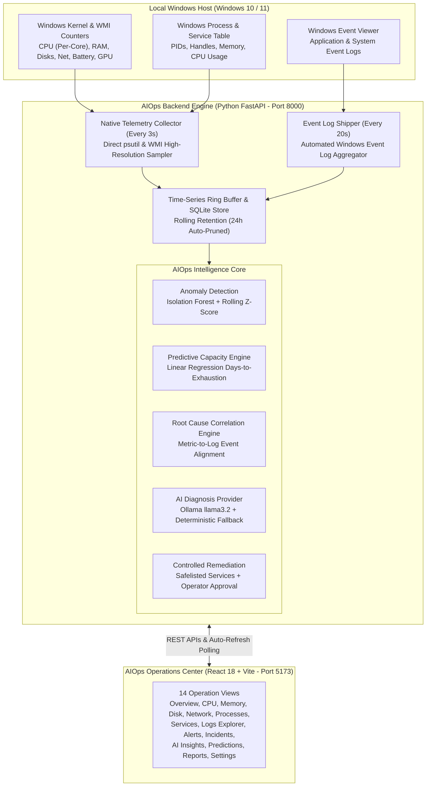

# Windows AIOps Monitoring & Intelligence Platform

[](https://microsoft.com)
[](https://fastapi.tiangolo.com)
[](https://python.org)
[](https://react.dev)
[](https://www.typescriptlang.org)
[](https://tailwindcss.com)
[](https://sqlite.org)

An ultra-lean, production-grade, locally hosted **Pure Full-Stack AIOps (Artificial Intelligence for IT Operations)** platform designed specifically for Windows laptops and workstations.

The platform continuously samples real-time system metrics, Windows Application and System event logs, process resource trees, and hardware health—employing machine learning anomaly detection (`IsolationForest`), predictive capacity forecasting, automated root-cause cross-correlation, and AI diagnostics.

> [!NOTE]
> **Pure Full-Stack Architecture**: Runs with **0 Docker containers**, **0 external exporter binaries**, and **0 external databases**. Everything is self-contained within Python (FastAPI) and TypeScript (React), utilizing less than **150 MB of RAM** total.

---

## Architecture Overview



---

## Key Capabilities

### 1. Native Real-Time Telemetry & Hardware Monitoring
- **CPU**: Total & per-core utilization, user/privileged mode breakdown, interrupts, and context switches.
- **Memory**: Total, used, available physical RAM, committed memory, paging file activity, and file cache.
- **Storage**: Volume capacity, read/write MB/s throughput, and free space percentage on logical disks (`C:`, `D:`).
- **Network**: Real-time upload/download throughput (Mbps), interface states, and packet transfer rates.
- **Processes & Services**: Top CPU and memory consuming processes, process IDs, and Windows service status matrix.
- **Genuine Hardware Sensors**: Real battery state of charge (percentage & minutes remaining), Intel UHD GPU identification, and clear reporting of unsupported motherboard thermal sensors without fabrication.

### 2. Windows Event Log Aggregation
- Ingests native Windows **Application** and **System** event logs directly into the local database.
- Severity classification: `Information`, `Warning`, `Error`, and `Critical`.
- Full-text search and filtering in the Logs Explorer tab.

### 3. Python AIOps Intelligence Engine
- **Anomaly Detection**: Combines **Isolation Forest** (unsupervised ML) with dynamic **Rolling Z-Score** ($Z > 2.5$) over a 30-minute window to filter normal operational noise from authentic anomalies.
- **Predictive Capacity Forecasting**: Computes linear trend slopes to forecast disk space and memory exhaustion horizons (e.g., *C: storage degradation rate, estimated days remaining*) with statistical confidence ratings.
- **Automated Root-Cause Analysis (RCA)**: Correlates metric spikes with Windows Event log warnings and offending processes across identical time boundaries.
- **AI Diagnostics**: Integrates with local **Ollama** (`llama3.2`) for natural language diagnosis. If Ollama is offline, automatically engages the built-in **Deterministic Grounded AI Engine**.

### 4. Controlled Remediation Framework
- Strict safelist-only execution model:
  - Windows Services: `Spooler` (Print Spooler), `W32Time` (Windows Time), `LanmanWorkstation` (Workstation).
  - Storage: System `%TEMP%` cache cleanup.
- **Two-phase approval**: Requires explicit operator confirmation before performing any corrective action.
- **Auditing**: Every remediation action, status, and output is permanently preserved in the database audit log.

### 5. Modern Operations Center Web UI
Built with React 18, TypeScript, Tailwind CSS, Lucide icons, and Recharts:
- **14 Dedicated Operation Pages**: Overview, CPU, Memory, Disk, Network, Processes, Services, Logs Explorer, Alerts, Incidents, AI Insights, Predictions, Reports, and System Settings.
- Dark mode theme designed for NOC / SRE operations.
- Direct PDF and CSV operational report generation.

---

## Service Directory & Port Map

| Component | Port | Local URL | Description |
|---|---|---|---|
| **AIOps Web UI** | `5173` | [http://localhost:5173](http://localhost:5173) | React Operations Center |
| **FastAPI Backend** | `8000` | [http://localhost:8000](http://localhost:8000) | REST API & Interactive Docs ([/docs](http://localhost:8000/docs)) |
| **Embedded Database** | Local File | `data/aiops_local.db` | High-speed embedded SQLite database |

---

## Quickstart & Installation

### Prerequisites
- **OS**: Windows 10/11 64-bit
- **Memory**: Minimum 4 GB RAM (Platform uses < 150 MB)
- **Python**: Python 3.10+ (Python 3.12 verified)
- **Node.js**: Node 18+ and npm

### 1. Install Dependencies (One-time Setup)
```powershell
# Navigate to project directory
cd "D:\Breakthru All Files\AIops-project"

# Backend dependencies
cd backend
pip install -r requirements.txt
cd ..

# Frontend dependencies & build
cd frontend
npm install
npm run build
cd ..
```

### 2. Launch the Platform with One Command
```powershell
powershell -ExecutionPolicy Bypass -File .\scripts\start.ps1
```

### 3. Verify System Health
```powershell
powershell -ExecutionPolicy Bypass -File .\scripts\health-check.ps1
```

Expected output:
```text
========================================================
       WINDOWS AIOPS PLATFORM HEALTH VERIFICATION       
       (Pure Full-Stack: Python Backend + React UI)     
========================================================

[ PASS ] FastAPI Backend API is healthy (http://127.0.0.1:8000/api/health)
[ PASS ] React Operations UI is healthy (http://127.0.0.1:5173)
[ PASS ] Live Telemetry Gauges is healthy (http://127.0.0.1:8000/api/system/overview)
[ PASS ] Windows Event Logs is healthy (http://127.0.0.1:8000/api/system/logs)
[ PASS ] AI Predictive Engine is healthy (http://127.0.0.1:8000/api/ai/predictions)

Summary: 5 / 5 core subsystems verified operational.
```

### 4. Stop the Platform
```powershell
powershell -ExecutionPolicy Bypass -File .\scripts\stop.ps1
```

---

## Directory Structure

```text
D:\Breakthru All Files\AIops-project\
├── backend/                        # FastAPI Application & AI Engine
│   ├── app/
│   │   ├── ai/                     # Anomaly detection, forecasting, RCA, Ollama
│   │   ├── api/                    # System, alerts, incidents, AI, remediation routes
│   │   ├── database/               # SQLite session & SQLAlchemy schemas
│   │   ├── models/                 # Pydantic API response models
│   │   ├── reports/                # PDF & CSV report generation
│   │   ├── services/               # Native telemetry sampler & Windows event log collector
│   │   ├── config.py               # Application settings
│   │   └── main.py                 # Application bootstrap & lifecycle
│   └── requirements.txt            # Python dependencies
├── frontend/                       # Vite + React 18 + TypeScript + Tailwind UI
│   ├── src/
│   │   ├── components/             # Reusable UI cards, tables, charts
│   │   ├── pages/                  # 14 NOC & Operations Views
│   │   ├── services/               # Axios / fetch API client
│   │   ├── types/                  # TypeScript interface contracts
│   │   ├── App.tsx                 # Routing & Navigation Layout
│   │   └── index.css               # Tailwind styling & dark theme
│   └── package.json                # Frontend dependencies
├── data/                           # Local embedded SQLite storage & generated reports
│   ├── aiops_local.db              # Rolling time-series & incident database
│   └── reports/                    # Exported PDF and CSV health reports
├── scripts/                        # Automation & Operational PowerShell Scripts
│   ├── health-check.ps1            # 5-point automated health verifier
│   ├── start.ps1                   # One-click startup for Backend & Frontend
│   ├── stop.ps1                    # One-click graceful shutdown
│   ├── start-backend.ps1           # Standalone background backend launcher
│   └── setup-windows-autostart.ps1 # Windows Scheduled Task registrar
└── docs/                           # Technical documentation & architectural guides
```
