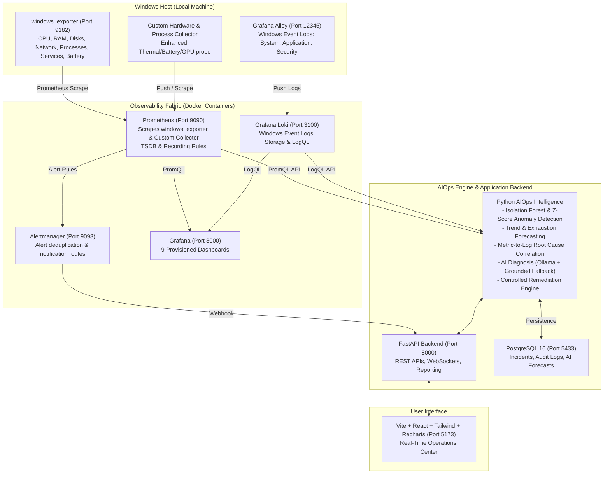

# Windows AIOps Architecture & System Baseline

## Host Environment Validation (Phase 1 Baseline)

- **Operating System**: Microsoft Windows 11 Pro 64-bit (Build 10.0.26200)
- **Processor**: Intel Core i5-8350U (4 Cores, 8 Logical Processors @ 1.70GHz)
- **Physical Memory**: 8 GB RAM (~7.88 GB visible). Free RAM during baseline: ~2.95 GB.
- **Storage**:
  - `C:\`: ~25.6 GB free
  - `D:\`: ~74.7 GB free (`D:\Breakthru All Files\AIops-project`)
- **Docker Engine**: Docker CLI 29.6.2, Docker Compose v5.3.1. Engine backed by WSL2 (`docker-desktop` distro).
- **WSL2**: Active (Kernel 6.18.33.2-microsoft-standard-WSL2).
- **Python**: Python 3.12.10
- **Node.js / npm**: Node v24.18.1, npm 11.16.0
- **Pre-existing Services**: Native PostgreSQL 18 running on port 5432. AIOps PostgreSQL is configured to use port `5433` to prevent port collision.

---

## Architectural Data Flow

---

## Port Allocation Matrix

| Component | Port | Host Binding | Status |
|---|---|---|---|
| windows_exporter | 9182 | 127.0.0.1:9182 | Native Windows Service / Executable |
| Prometheus | 9090 | 127.0.0.1:9090 | Docker Container |
| Grafana | 3000 | 127.0.0.1:3000 | Docker Container |
| Loki | 3100 | 127.0.0.1:3100 | Docker Container |
| Alertmanager | 9093 | 127.0.0.1:9093 | Docker Container |
| AIOps PostgreSQL | 5433 | 127.0.0.1:5433 | Docker Container (avoids conflict with native 5432) |
| FastAPI Backend | 8000 | 127.0.0.1:8000 | Python Process / Container |
| React UI | 5173 | 127.0.0.1:5173 | Vite Dev Server / Container |
| Grafana Alloy | 12345 | 127.0.0.1:12345 | Native Windows Agent |
